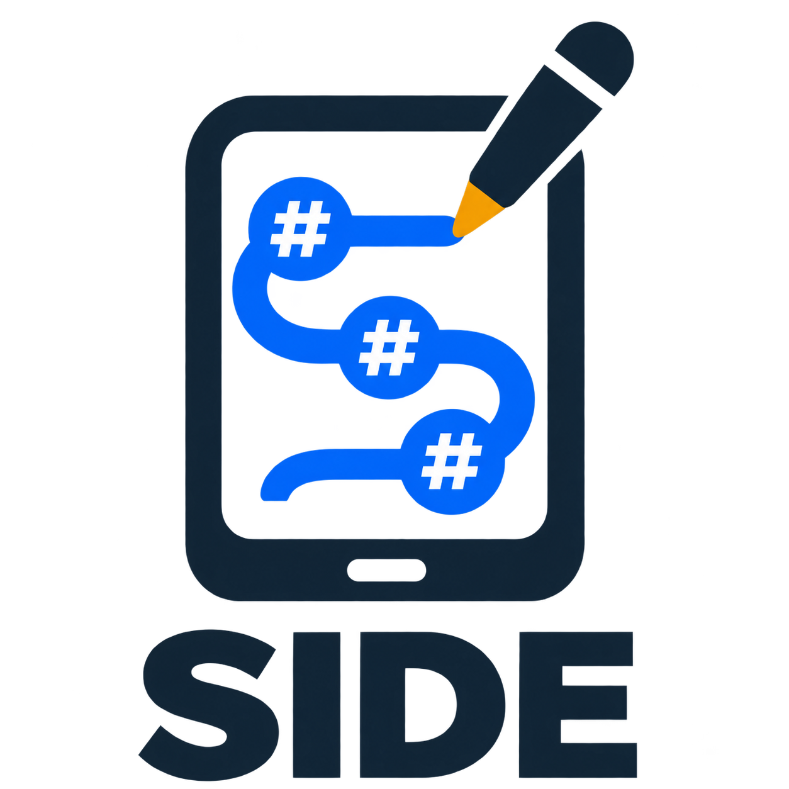

# SIDE

<div align="center">

</div>

> # **SIDE** : **S**eparate **I**nscriber for **D**evice **E**vidence

SIDE keeps the session logs of AI coding agents (Claude Code, Codex CLI, Antigravity) usable as evidence.
Install it once on an employee's PC, and a service the employee cannot control binds every new line an
agent writes into a hash chain within seconds. After an incident, the organization discloses only the
records related to the incident, and a verifier checks them with the published seal public key alone.

SIDE는 AI 코딩 에이전트(Claude Code, Codex CLI, Antigravity)의 세션 로그를 증거로 쓸 수 있게 지켜 줍니다.
직원 PC에 한 번 설치하면, 직원이 제어할 수 없는 서비스가 에이전트가 새로 쓰는 행을 몇 초 안에 해시 체인에
묶습니다. 사건이 나면 조직은 사건에 관련된 레코드만 제출하고, 검증자는 공개된 봉인 공개 키 하나로 검증합니다.

| What you get | Meaning | 의미 |
|--------------|---------|------|
| Tamper detection | Lines changed, deleted, or reordered after binding, and session logs deleted after SIDE read them, are detected | 묶인 뒤 바뀌거나 지워지거나 순서가 바뀐 행과 SIDE가 읽은 뒤 지워진 세션 로그를 탐지 |
| Selective disclosure | Disclose only incident records; the undisclosed records are proven to exist without revealing their content | 사건 관련 레코드만 제출하고, 제출하지 않은 레코드는 내용 없이 존재만 증명 |
| Out of the employee's reach | Binding runs under the Windows system account; a standard user cannot stop it or write its chains | 묶기는 Windows SYSTEM 계정으로 실행되어 표준 사용자는 멈추거나 체인을 고칠 수 없음 |
| No outside party | No server, blockchain, or dedicated hardware, and no network use. Python standard library only | 서버·블록체인·전용 장비가 필요 없고 네트워크를 쓰지 않음. Python 표준 라이브러리만 사용 |

SIDE has three roles.
SIDE에는 세 역할이 있습니다.

| Role | What the role does | 역할이 하는 일 | Folder |
|------|--------------------|---------------|--------|
| Employee | Works as usual. Owns the session logs and runs no SIDE tool | 평소처럼 일함. 세션 로그의 주인이며 SIDE 도구를 실행하지 않음 | — |
| Organization | IT staff install and collect on the employee PC; security staff sign the seal and disclose on an organization PC | IT 담당이 직원 PC에서 설치·수거하고, 보안 담당이 조직 PC에서 봉인 서명·제출 | `employee\`, `organization\` |
| Verifier | An auditor, opposing party, or regulator checks the disclosure package | 감사인·소송 상대·규제 기관이 제출 패키지를 검증 | `verifier\` |

---

## 1. Getting started / 시작하기

1. Use Windows 10 or 11 with Python 3.10 or later from [python.org](https://www.python.org/downloads/). No `pip install` is needed.
   Windows 10 또는 11과 [python.org](https://www.python.org/downloads/)의 Python 3.10 이상을 씁니다. `pip install`은 필요 없습니다.
   - On the employee PC, install Python *for all users*. The python.org default installs into your user folder,
     and the SYSTEM service refuses that Python. Use *Windows installer (64-bit)* → *Customize installation* →
     tick *Install Python for all users* → the location becomes `C:\Program Files\Python3xx`.
     직원 PC에는 Python을 *모든 사용자용*으로 설치합니다. python.org 기본 설치는 사용자 폴더에 들어가고, SYSTEM
     서비스는 그 Python을 거부합니다. *Windows installer (64-bit)* → *Customize installation* →
     *Install Python for all users* 체크 → 설치 위치가 `C:\Program Files\Python3xx`가 되면 됩니다.
   - For the verifier window, keep *tcl/tk and IDLE* turned on (the default).
     검증 창을 쓰려면 *tcl/tk and IDLE*을 켜 둡니다(기본값).
2. Download this repository (`git clone` or *Code → Download ZIP*) and copy only the role folder each PC
   needs to a local drive: `employee\` to the employee PC, `organization\` to the organization PC,
   `verifier\` to the verifier. Each folder works on its own.
   이 저장소를 내려받고(`git clone` 또는 *Code → Download ZIP*) PC마다 필요한 역할 폴더만 로컬 드라이브에
   복사합니다. 직원 PC에는 `employee\`, 조직 PC에는 `organization\`, 검증자에게는 `verifier\`를 복사하며, 폴더마다 따로 동작합니다.
3. Follow [Usage](#4-usage--사용법).
   [사용법](#4-usage--사용법)을 따릅니다.

---

## 2. Folder layout / 폴더 구조

```
SIDE\
  ├─ organization\     ← organization PC: 1_ to 5_*.bat, lib\, keys, received collections, disclosures / 조직 PC
  ├─ employee\         ← employee PC (run by IT): 1_ to 9_*.bat, lib\, seal_pub.hex in, collections out / 직원 PC
  ├─ verifier\         ← verifier: 1_viewer.bat, 2_check_package.bat, lib\ / 검증자
  ├─ tests\            ← automated test, sync_libs.py (keeps the lib\ folders equal) / 자동 시험, lib\ 동기화
  ├─ field-test\       ← test on a real Windows PC / 실제 Windows PC 시험
  └─ docs\             ← detailed guide / 자세한 안내
```

---

## 3. How it works / 동작 흐름

```
Phase 0: Enrollment, once / 가입, 한 번
  organization ── seal key pair ──► seal_pub.hex ──► employee PC
  employee PC  ── install, enroll, move root key K0 off the PC ──► organization

Phase 1: Binding at creation time, every day / 생성 시점 묶기, 매일
  employee PC  ── the employee works as usual; at every sweep (2 s) the service binds new complete lines

Phase 2: Sealing, disclosure, and verification, after an incident / 봉인·제출·검증, 사건 이후
  employee PC  ── collect and seal ──► SIDE_collection_*.zip ──► organization
  organization ── sign the seal, verify, disclose ──► SIDE_disclosure_*.json ──► verifier
  verifier     ── check the package with seal_pub.hex ──► accept / reject
```

---

## 4. Usage / 사용법

In the tables below, double click the files in the *Double click* column in step order. Only the files in
`employee\` need administrator rights (*Admin* **Yes**).
아래 표의 *Double click* 열에 있는 파일을 단계 순서대로 더블 클릭합니다. 관리자 권한이 필요한 것은
`employee\`의 파일뿐입니다(표의 *Admin*이 **Yes**).

- **`employee\` files ask for administrator rights** — the file reopens itself and Windows shows *User Account
  Control*; click *Yes*. If it asks for a password, IT staff type an administrator account and password.
  `employee\`의 파일은 관리자 권한으로 스스로 다시 열리며, 이때 *사용자 계정 컨트롤* 창이 뜹니다. *예*를 누릅니다.
  암호를 물으면 IT 담당이 관리자 계정과 암호를 입력합니다.
- **Type paths in an administrator window** — dragging a file onto a window that runs as administrator does not
  work, so type the path (for example `E:\`). The files in `organization\` and `verifier\` run without
  administrator rights, so you can drag files and folders onto their windows.
  관리자 권한으로 열린 창에는 끌어 놓기가 되지 않으므로 경로를 직접 입력합니다(예: `E:\`). `organization\`과
  `verifier\`의 파일은 관리자 권한 없이 열리므로, 파일이나 폴더를 창에 끌어 놓아 경로를 넣을 수 있습니다.
- **Run from a local drive** — the administrator window cannot see mapped network drives. If Windows shows
  *Windows protected your PC* for a downloaded file, choose *More info → Run anyway*.
  관리자 권한으로 열린 창은 연결된 네트워크 드라이브를 보지 못하므로 로컬 드라이브에서 실행합니다. 내려받은
  파일에 *Windows의 PC 보호* 창이 뜨면 *추가 정보 → 실행*을 누릅니다.

### Phase 0: Enrollment / 가입

| Step | Where | Admin | Double click | What happens | 하는 일 |
|:---:|-------|:---:|--------------|--------------|--------|
| 1 | organization PC | No | `organization\1_make_seal_key.bat` | Makes the seal key pair. Copy `organization\seal_pub.hex` into `employee\` on the employee PC. The private key stays here. | 봉인 키 쌍을 만듭니다. `organization\seal_pub.hex`를 직원 PC의 `employee\`에 넣습니다. 개인 키는 이 조직 PC에만 둡니다. |
| 2 | employee PC | **Yes** | `employee\1_install.bat` | Asks for the employee account (Enter = the account signed in now; if an administrator is signed in, type the employee's `PC-NAME\name`. The employee must have signed in once), installs the binding service, and enrolls the PC. It then asks for a USB folder (type it, for example `E:\`), moves the root key K0 there, and erases the PC copy. Give the `SIDE_custody_*` folder to the organization. | 묶을 직원 계정을 묻고(Enter = 지금 로그인한 계정, 관리자로 로그인했다면 직원의 `PC이름\이름` 입력. 직원은 한 번 이상 로그인했어야 함) 서비스를 설치해 PC를 가입시킵니다. 이어 USB 폴더를 물어(예: `E:\` 입력) 루트 키 K0를 옮기고 PC 사본을 지웁니다. `SIDE_custody_*` 폴더를 조직에 넘깁니다. |
| 3 | employee PC | **Yes** | `employee\2_move_root_key.bat` | Only if step 2 did not move the root key. | 2단계에서 루트 키를 옮기지 않은 경우에만 실행합니다. |

### Phase 1: Binding / 묶기

| Step | Where | Admin | Double click | What happens | 하는 일 |
|:---:|-------|:---:|--------------|--------------|--------|
| 4 | employee PC | — | — | Nothing to do. The service binds in the background and starts at every boot. | 할 일이 없습니다. 서비스가 백그라운드에서 묶으며, 부팅할 때마다 스스로 시작합니다. |
| 5 | employee PC | **Yes** | `employee\3_status.bat` | Shows whether the service runs, the device ledger, and the number of session chains. | 서비스 동작 여부, 단말 기록부, 세션 체인 수를 보여 줍니다. |

### Phase 2: Sealing, disclosure, verification / 봉인·제출·검증

| Step | Where | Admin | Double click | What happens | 하는 일 |
|:---:|-------|:---:|--------------|--------------|--------|
| 6 | employee PC | **Yes** | `employee\4_collect.bat` | Stops the service, seals the chains, and writes `employee\collections\SIDE_collection_*.zip`. Choose [2] to include the session logs (conversation text). | 서비스를 멈추고 체인을 봉인해 `SIDE_collection_*.zip`을 만듭니다. 세션 로그(대화 원문)를 넣으려면 [2]를 고릅니다. |
| 7 | organization PC | No | `organization\2_receive_collection.bat` | Drag in the zip and the `SIDE_custody_*` folder. Compares the enrollment certificate with the custody copy, signs the seal, and verifies every chain with K0. The result goes to `verification_result.txt`. | zip과 `SIDE_custody_*` 폴더를 끌어 놓습니다. 가입 증서를 보관본과 대조하고 봉인에 서명한 뒤 K0로 모든 체인을 검증합니다. 결과는 `verification_result.txt`에 남습니다. |
| 8 | organization PC | No | `organization\3_disclose.bat` | Pick a session and the records to disclose, and send `organization\disclosures\SIDE_disclosure_*.json` to the verifier. Choose [2] to also write the text of those lines (`.lines.jsonl`); this needs a collection made with [2] in step 6. | 세션과 제출할 레코드를 골라 `SIDE_disclosure_*.json`을 검증자에게 보냅니다. 그 행의 원문(`.lines.jsonl`)도 함께 만들려면 [2]를 고릅니다. 6단계에서 [2]로 수거한 경우에만 됩니다. |
| 9 | verifier | No | `verifier\1_viewer.bat` | Opens the viewer. Load the package and the `seal_pub.hex` the organization published in advance. It checks inclusion, record count, and seal signature, and shows accept or reject. | 검증 창을 엽니다. 패키지와 조직이 미리 공개한 `seal_pub.hex`를 열면 포함 증명·레코드 수·봉인 서명을 확인해 수용 또는 거부를 보여 줍니다. |

Without a window, the verifier double clicks `verifier\2_check_package.bat`. Before sending a package, the
organization can preview the verdict with `organization\4_verify_package.bat` or `5_viewer.bat`.
See [docs/guide.md](docs/guide.md) for every option.

창 없이 검증하려면 `verifier\2_check_package.bat`를 더블 클릭합니다. 조직은 패키지를 보내기 전에
`organization\4_verify_package.bat`나 `5_viewer.bat`로 판정을 미리 볼 수 있습니다.
모든 옵션은 [docs/guide.md](docs/guide.md)에 있습니다.

<details>
<summary>Command-line equivalents / 명령줄로 실행하기</summary>

Run inside the role folder. / 역할 폴더 안에서 실행합니다.

| Step | Command |
|:---:|---------|
| 1 | `python lib\side.py organization seal-key` |
| 2 | `python lib\side.py employee install [--employee <account>] [--key-out <folder>]` (administrator) |
| 3 | `python lib\side.py employee root-key --key-out <folder>` (administrator) |
| 5 | `python lib\side.py employee status` (administrator) |
| 6 | `python lib\side.py employee collect [--include-logs]` (administrator) |
| 7 | `python lib\side.py organization receive <zip> --custody <SIDE_custody_*> --seal-private-key <seal_secret.hex>` |
| 8 | `python lib\side.py organization disclose [--lines]` |
| 9 | `python lib\side.py verifier` · without a window: `python lib\side.py verifier check <package> --seal-public-key <seal_pub.hex> [--lines <file>]` |

</details>

---

## 5. Testing / 시험

Before you rely on SIDE as evidence, check that it works on your machine: run the tests after you download or change it.
SIDE를 증거로 쓰기 전에 내 환경에서 동작하는지 확인합니다. 내려받거나 코드를 고친 뒤 시험을 실행합니다.

| Test | Where | What it shows | 확인하는 것 |
|------|-------|---------------|------------|
| `python tests\test_end_to_end.py` | Any PC, no admin rights, installs nothing | The whole flow works and tampering is detected | 전 과정 동작과 조작 탐지 |
| `field-test\` | A spare test PC with admin rights | The real service survives employee attacks | 실제 서비스가 직원의 공격을 견디는지 |

Do not run `field-test\` on a work PC. See [docs/field-test-manual.md](docs/field-test-manual.md).
`field-test\`는 업무용 PC에서 돌리지 마십시오. [docs/field-test-manual.md](docs/field-test-manual.md)를 참고하세요.

---

## 6. FAQ / 자주 묻는 질문

**"Administrator rights are required." appears. What should I do? / "Administrator rights are required."가 뜹니다. 어떻게 하나요?**  
The employee PC `.bat` files ask through User Account Control; click *Yes*, or sign in with an administrator account. On the command line, open the terminal with *Run as administrator*.  
직원 PC의 `.bat` 파일은 사용자 계정 컨트롤 창으로 권한을 요청합니다. *예*를 누르거나 관리자 계정으로 로그인합니다. 명령줄에서는 터미널을 *관리자 권한으로 실행*합니다.

**Why does the install refuse my Python? / 설치가 Python을 왜 거부하나요?**  
The SYSTEM service will not run a Python under a user folder or from the Microsoft Store, because its owner could change it. Reinstall from python.org *for all users*.  
사용자 폴더나 Microsoft Store의 Python은 그 주인이 바꿀 수 있어 SYSTEM 서비스가 실행하지 않습니다. python.org에서 *모든 사용자용*으로 다시 설치합니다.

**Why does the viewer window not open? / 검증 창이 왜 뜨지 않나요?**  
Python was installed without tcl/tk. Rerun the python.org installer and turn on *tcl/tk and IDLE*.  
tcl/tk 없이 설치된 Python입니다. python.org 설치 파일을 다시 실행해 *tcl/tk and IDLE*을 켭니다.

**Why does the viewer reject the package? / 검증 창이 왜 패키지를 거부하나요?**  
A package without the organization's seal signature, or checked with another public key, is rejected. Use a package made in step 8 (step 7 signs the seal) and the `seal_pub.hex` the organization published.  
조직의 봉인 서명이 없거나 다른 공개 키로 확인한 패키지는 거부됩니다. 8단계에서 만든 패키지(7단계에서 봉인에 서명됨)와 조직이 공개한 `seal_pub.hex`를 씁니다.

**Why does the device ledger show "no matching service_stop" after a reboot? / 재부팅 뒤 단말 기록부에 "no matching service_stop"이 왜 뜨나요?**  
Shutdown ends the service without a stop record, so that interval counts as an abnormal stop. Compare its time with the PC's boot record; the next `service_start` shows when binding resumed.  
PC를 끄거나 다시 시작하면 서비스가 정지 기록 없이 끝나므로, 그 구간은 비정상 정지로 남습니다. 그 시각을 PC의 부팅 기록과 비교하고, 다음 `service_start`로 묶기가 다시 시작된 때를 확인합니다.

**Does SIDE send data anywhere? / SIDE가 데이터를 밖으로 보내나요?**  
No. SIDE uses no network. Records leave the PC only when the organization collects them.  
아닙니다. SIDE는 네트워크를 쓰지 않습니다. 기록은 조직이 수거할 때만 PC를 떠납니다.

**When does SIDE not apply? / SIDE가 적용되지 않는 경우는?**  
SIDE assumes the employee is a standard user on a PC that someone else administers. If the employee holds administrator rights, the account separation no longer holds. SIDE shows that records existed and stayed unchanged, not that their content is true or complete.  
SIDE는 직원이 다른 사람이 관리하는 PC의 표준 사용자라고 전제합니다. 직원이 관리자 권한을 가지면 계정 분리가 성립하지 않습니다. SIDE는 레코드가 존재했고 바뀌지 않았음을 보일 뿐, 그 내용이 참이거나 빠짐없음을 보이지는 않습니다.

**What can SIDE not catch? / SIDE가 잡지 못하는 것은?**  
- A line changed before the next sweep binds it (unobserved window, about 2 seconds).  
  다음 훑기가 묶기 전에 바뀐 행(미관측 구간, 약 2초).
- Reads blocked with share-deny. SIDE cannot read the file meanwhile, but the device ledger records each failed read. SIDE protects the chain, not the session log file itself.  
  공유 거부(share-deny)로 막힌 읽기. 그동안 읽지 못하지만 읽기 실패는 단말 기록부에 남습니다. SIDE는 체인을 지키며 세션 로그 파일 자체는 지키지 않습니다.
- Anyone who copies the root key K0 before it leaves the PC can recompute the tags (key window at enrollment). Move K0 right after install.  
  루트 키 K0가 PC를 떠나기 전에 복사한 사람은 태그를 다시 계산할 수 있습니다(가입 시점 키 노출). 설치 직후 K0를 옮기십시오.
- The minutes between boot and service start, and service stops by an administrator. Both appear in the device ledger.  
  부팅부터 서비스 시작까지의 몇 분과 관리자의 서비스 중지. 둘 다 단말 기록부에 남습니다.

A mismatch alone is not evidence of tampering, because agent compaction and service stops raise the same signals, and a person decides. We plan to address these limitations in a future version.  
불일치 하나만으로는 조작의 증거가 아닙니다. 에이전트의 대화 압축(compaction)과 서비스 정지도 같은 신호를 내며, 판단은 사람이 합니다. 이 한계들은 향후 버전에서 보완할 계획입니다.

---

## 7. Citation / 인용

SIDE accompanies a paper that is currently under review. Citation details will be added once it is published.
SIDE는 현재 심사 중인 논문과 함께 공개됩니다. 논문이 게재되면 인용 정보를 추가합니다.

---

## 8. License / 라이선스

```
SPDX-FileCopyrightText: 2026 Soojin Kang, Donghwoo Cho, Jongsung Kim (DF&C Lab., Department of Cyber Security, Kookmin University, Republic of Korea)
SPDX-License-Identifier: Apache-2.0
```

See LICENSE and NOTICE. You may use, modify, and redistribute SIDE if you keep the copyright notice and the license.
LICENSE와 NOTICE를 참고하세요. 저작권 고지와 라이선스를 유지하면 자유롭게 사용·수정·재배포할 수 있습니다.

## Contributors / 기여자

|  |  |
|:---:|:---:|
| [Soojin Kang](https://github.com/kangmelon) | [Donghwoo Cho](https://github.com/donghwoocho) |
